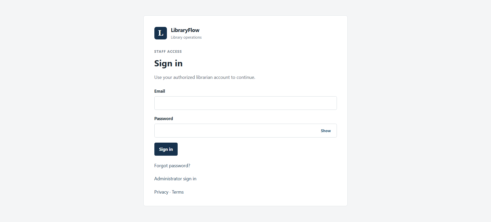
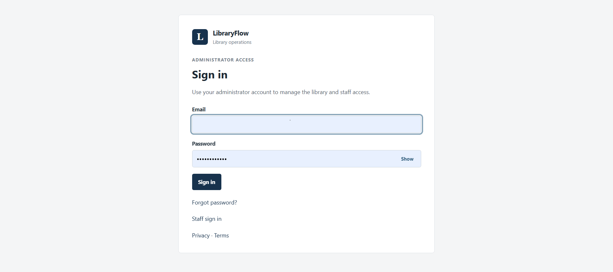
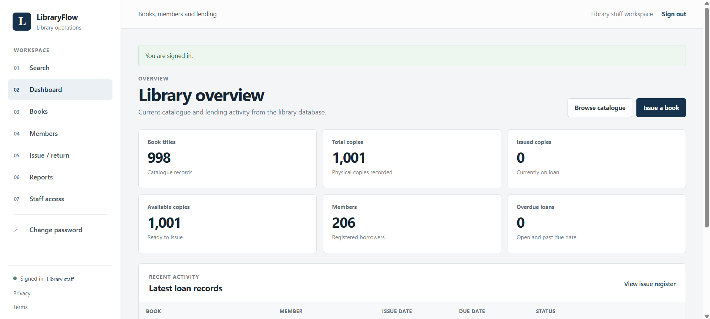
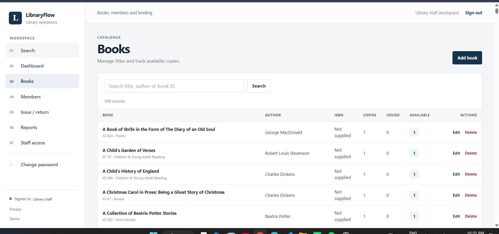
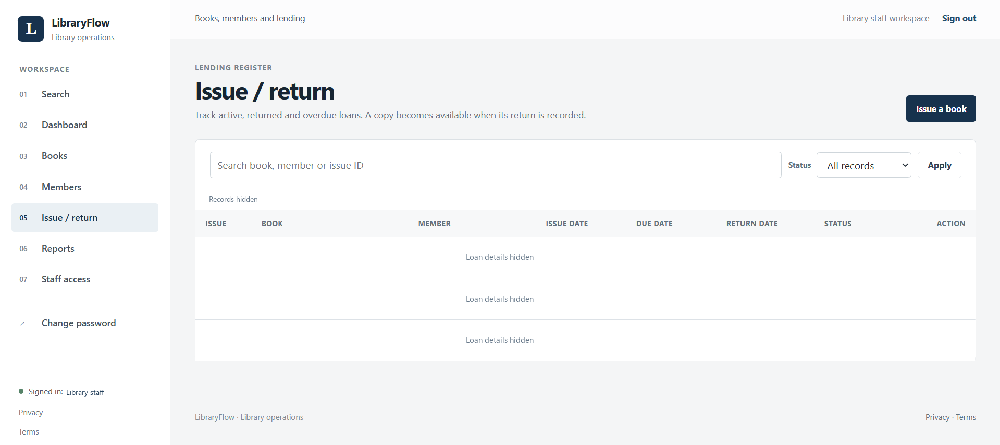
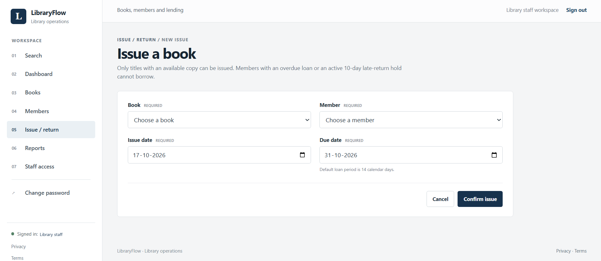
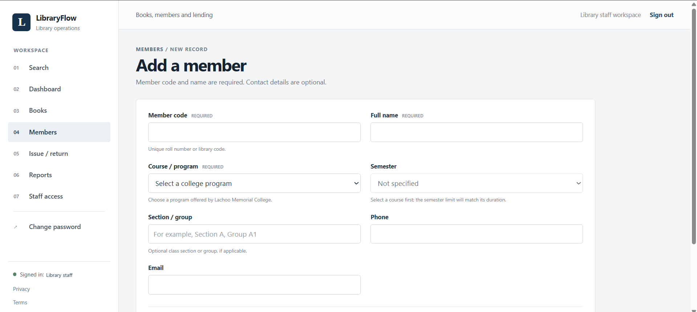
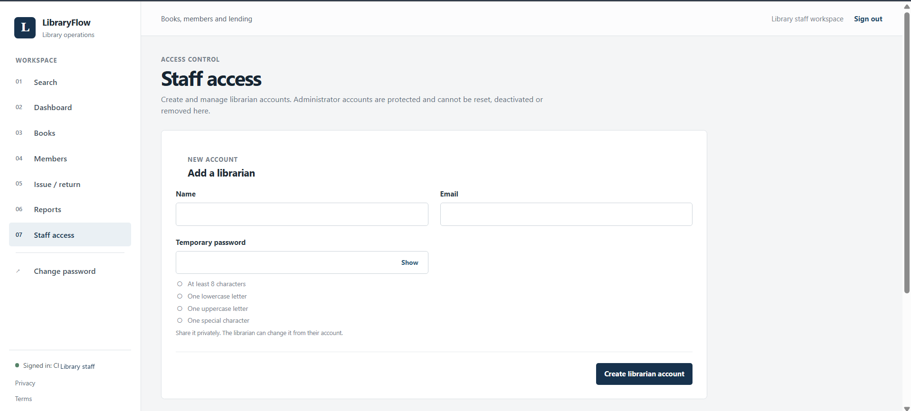
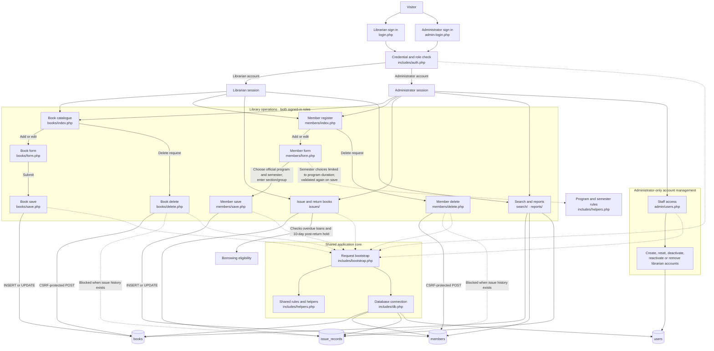

# LibraryFlow

LibraryFlow is a PHP and MariaDB library operations application for managing a book catalogue, members, loans, returns and inventory reports. Administrators and librarians use separate sign-in pages.

The repository contains the application source, SQL schema, synthetic catalogue data and this setup guide.

## Features

- Search, create and edit books and member records.
- Issue and return books with server-side availability checks and transaction locking.
- View current inventory, open loans and overdue records.
- Protect write requests with CSRF tokens and use prepared SQL statements.
- Require staff sign-in; staff can change their passwords, and administrators can reset librarian passwords, deactivate or reactivate librarian access, and permanently remove librarian accounts. Administrator accounts are protected from staff-management actions.
- Let staff show or hide password entries and request a one-use password reset link by email. Reset links expire after one hour, are stored as hashes, and revoke existing sessions after a password change. Administrators can still set a librarian password if email recovery is unavailable.
- Require new passwords to be at least 8 characters and include a lowercase letter, an uppercase letter and a special character. A late return starts a 10-day borrowing hold after the book is returned; an outstanding overdue loan also blocks new issues.
- Let any signed-in staff member delete eligible book and member records; issue history remains protected by foreign keys.
- Offer the current Lachoo Memorial College programs in the member form and limit semester choices to each program's published duration.
- Include the 206-record BCA V Semester classroom roster seed; local credentials, contact details and lending history stay out of Git.

## Interface preview

The screenshots follow the main LibraryFlow workflow from account access through catalogue and lending operations. Personal account names, the administrator email, and row-level loan details are hidden in these public previews.

<table>
  <tr>
    <td width="50%"><strong>1. Staff sign-in</strong>  <em>Authorized librarians sign in to the library workspace.</em></td>
    <td width="50%"><strong>2. Administrator sign-in</strong>  <em>Administrators use a separate sign-in route for account management.</em></td>
  </tr>
  <tr>
    <td width="50%"><strong>3. Dashboard</strong>  <em>Review catalogue, copy, member and overdue-loan totals, plus recent activity.</em></td>
    <td width="50%"><strong>4. Book catalogue</strong>  <em>Search the catalogue and manage book records and copy availability.</em></td>
  </tr>
  <tr>
    <td width="50%"><strong>5. Issue and return register</strong>  <em>Filter lending records by status and open the book-issue workflow.</em></td>
    <td width="50%"><strong>6. Issue a book</strong>  <em>Select an available title and eligible member, then set issue and due dates.</em></td>
  </tr>
  <tr>
    <td width="50%"><strong>7. Add a member</strong>  <em>Register a member with a college program, matching semester and optional group/contact details.</em></td>
    <td width="50%"><strong>8. Staff access</strong>  <em>Administrators create and manage librarian accounts from the access-control page.</em></td>
  </tr>
</table>

## Architecture diagram

Administrators and librarians use separate sign-in pages, and each page accepts only its matching account role. Both signed-in roles can add, edit and delete books and members. Delete requests require a CSRF-protected POST; database foreign keys prevent deleting records that have issue history. Only administrators can manage librarian accounts. Member program choices and semester limits are checked in the form and again by the save handler.

## Requirements

- PHP 8 or later with mysqli.
- MySQL or MariaDB with InnoDB.
- Apache with .htaccess overrides enabled, or equivalent server rules for the protected folders.
- A current browser.

## Local XAMPP setup

1. Copy the project to htdocs/libraryflow.
2. Start Apache and MySQL in XAMPP.
3. In phpMyAdmin, import database/libraryflow.sql, then database/libraryflow_demo_data.sql for the catalogue.
4. Import `database/bca_members.sql` after the schema and member-program migration to load the 206 BCA V Semester members. It contains roll numbers, names and section/group only; contact fields are empty and no issue history is inserted.
5. If the local database settings differ, copy config/local.php.example to config/local.php and set the local credentials. config/local.php is ignored by Git. The default root with an empty password is for local XAMPP development only.
6. From the same computer, open http://localhost/libraryflow/setup.php and create the first administrator. The one-time setup is limited to localhost and is disabled when APP_ENV=production.
7. Administrators sign in at http://localhost/libraryflow/admin-login.php. Librarians sign in at http://localhost/libraryflow/login.php. The two pages only accept their matching account role. Administrators can manage librarian accounts under Staff access.

For self-service password recovery, set `public_url` and `mail_from` in `config/local.php` and configure PHP's mail transport in `php.ini` or through the hosting provider. `public_url` is the full application base URL, such as `http://localhost/libraryflow` on local XAMPP or the HTTPS site URL in production. Local XAMPP does not include a configured mail service by default; set up an approved SMTP relay before expecting reset messages. PHP's `mail()` must accept the message for a link to remain usable. If mail is not configured or sending fails, the generic recovery page directs staff to an administrator, who can set a librarian password. Apply `database/migrations/20261016_password_reset.sql` to an existing database; a fresh import of `database/libraryflow.sql` already includes the recovery tables.

For an existing database, apply `database/migrations/20261017_member_programs.sql` once in phpMyAdmin. It adds a section/group field and converts the roster's stored `BCA V Semester Section ...` value into the `BCA` program plus its existing section/group. Fresh imports of `database/libraryflow.sql` already include the new field. For a project installed in another folder under htdocs, the application derives its base URL from the Apache document root.

## Database and sample data

database/libraryflow.sql creates the catalogue, member, issue, staff-user, login-throttling and password-recovery tables. It does not insert staff passwords. database/libraryflow_demo_data.sql contains Project Gutenberg catalogue metadata only and records its source. `database/bca_members.sql` seeds 206 BCA V Semester members with roll numbers, names and section/group; phone and email are left empty, and no lending history is included.

Do not add additional student contact details, borrowing history, database exports or backups to a public repository. Use only synthetic records for public screenshots. If sensitive information has already been committed, deleting the file in a later commit does not remove it from earlier Git history; follow GitHub's sensitive-data removal guidance.

## Roles

- Administrator: all library operations, deletes, and staff account/role management. Sign in at `/admin-login.php`.
- Librarian: catalogue, member, issue, return, search, reports and book/member deletes; cannot manage staff access.

The member form uses the active program list and semester durations published on Lachoo Memorial College's Science, Pharmacy, Computer Science, Commerce and Management, Physiotherapy, and Engineering program pages. Course limits are checked in both the browser form and the server save handler.

The first administrator is created through `setup.php`. The account's name, email, role and password hash are stored in the `users` table in the `libraryflow` database. The plain password is not saved; `config/local.php` contains database connection settings, not the administrator's password.

Passwords are hashed with PHP's password hashing API. Failed sign-in attempts and password reset requests are temporarily rate-limited by hashed email/IP keys. Reset tokens are random, one-use, expire after one hour, and only their SHA-256 hashes are stored. Sessions use HTTP-only, SameSite cookies, secure cookies when HTTPS is detected, expire after 30 minutes of inactivity, and rotate after sign-in and password changes. Changing or resetting a password invalidates other active sessions for that account.

## Configuration for an internet-facing deployment

XAMPP is a local development setup, not a public production host. Before allowing public or institutional access:

- Use a maintained production server with HTTPS and a database user limited to this application's database. Set APP_ENV=production, LIBRARYFLOW_DB_HOST, LIBRARYFLOW_DB_NAME, LIBRARYFLOW_DB_USER and LIBRARYFLOW_DB_PASSWORD; never use MySQL root.
- Create the first administrator while the server is restricted to localhost or an authenticated private tunnel, then switch to production mode before public access.
- Confirm the host enforces the repository's .htaccess protections or configure equivalent server rules. The database, config, includes and tmp folders must not be downloadable.
- For live deployment, move student records from this classroom seed to an institution-approved private system. Complete and approve the deployment-specific privacy notice and terms with the responsible institution's name, contact, purpose, retention, backup and support details.
- Configure encrypted backups, test restoration, restrict server/database administration, keep dependencies and PHP/MariaDB patched, and review logs so they do not contain student data or passwords.
- Run the application's acceptance and security checks in a staging copy with synthetic records before importing real data.

The privacy and terms pages describe the application but still require institution-specific review and completion. Their presence alone does not make a deployment production-ready.

## Checks

Run the HTTP smoke suite only against an isolated database whose name starts with libraryflow_test_. Start the PHP development server on loopback with APP_ENV=test and LIBRARYFLOW_DB_NAME=libraryflow_test_quality, then run tests/http-smoke.ps1 from a second PowerShell window. APP_ENV=test refuses to connect to any database that does not use that prefix. The suite creates synthetic users, books, members and loans; review and remove its test database after the run. Never point it at the live roster.

The isolated HTTP smoke suite covers role-separated authentication, sign-in throttling, session rotation and invalidation, protected administrator accounts, administrator and self-service password resets, reset-token revocation/reuse protections, password visibility controls, deactivation/permanent removal, password rules, CSRF, program and semester validation, CRUD, late-return borrowing holds, search, reporting, totals reconciliation and HTML escaping. Apache-specific access denial for database/config/docs files and backup restoration must also be checked on the target server.
