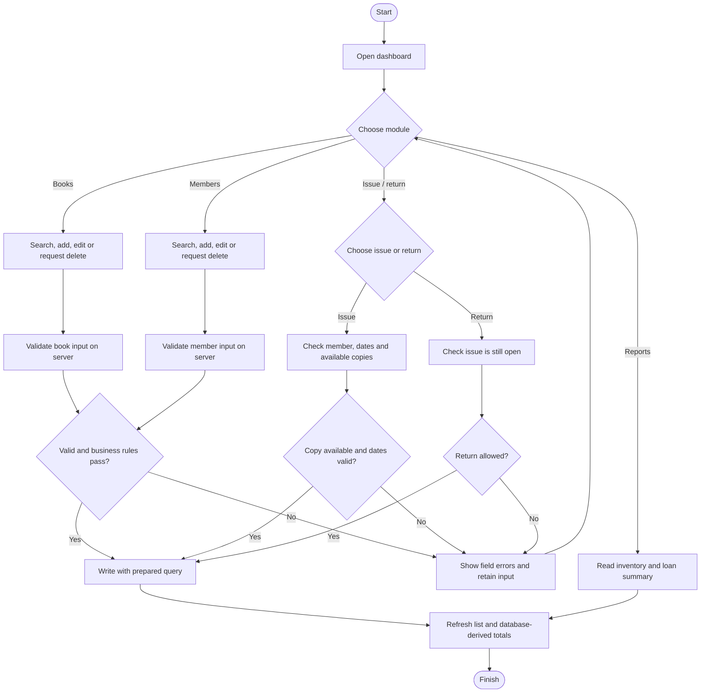
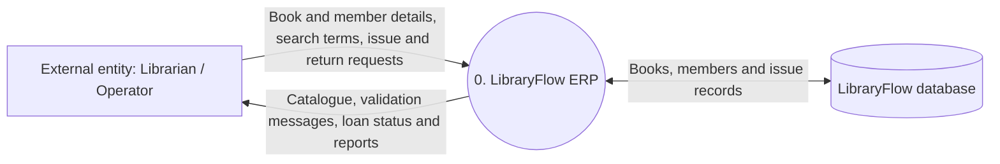
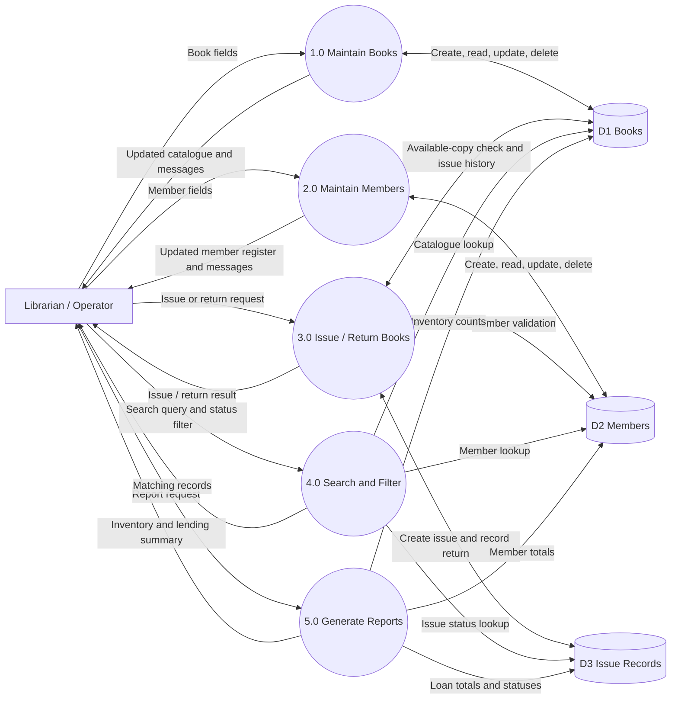
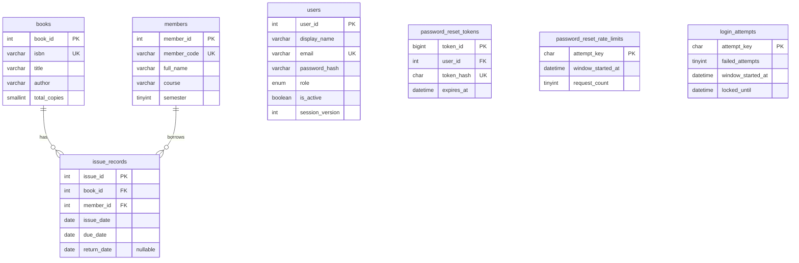
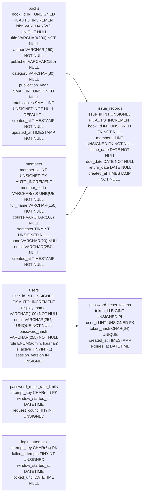

# LibraryFlow ERP Project Report

## Title page

| Item | Details |
| --- | --- |
| Project title | LibraryFlow ERP: Library Book and Issue Management System |
| Student name and roll number | Chandan, 243501033 |
| Course code | Not supplied in the project materials |
| Course name | Computer Graphics Mini Project, as stated in the supplied guidelines |
| Programme, semester and group | BCA V Semester, Section A, Group A2 |
| Faculty / department | Faculty of Computer Science |
| Faculty guide | Not supplied in the project materials |
| Academic year | 2026-27 |
| Report date | 16 October 2026 |
| GitHub repository | https://github.com/chandanprajapat-7568/LibraryFlow |

## Abstract

LibraryFlow ERP is a browser-based application for managing a single college library. It maintains a searchable book catalogue, student member register and issue/return history in MariaDB. Built with PHP 8, mysqli, Apache, HTML, CSS and vanilla JavaScript, it provides dashboard totals, book and member record management, combined search, lending reports and staff access with administrator and librarian roles. Administrators can create, deactivate, reactivate, reset or permanently remove librarian accounts; administrator accounts are protected. The lending workflow checks copy availability, rejects duplicate returns, blocks new issues while an open loan is overdue, and applies a 10-day borrowing hold after a late return. Staff can show or hide password entries, set new passwords with at least eight characters including lowercase, uppercase and a special character, and request one-use email reset links that expire after one hour. Prepared statements, server-side validation, CSRF protection, password hashing, session checks and rate limits protect account and database operations. The public source includes the schema and a 1,000-entry Project Gutenberg catalogue seed; the real student roster and local credentials are excluded. The isolated HTTP suite passed 103 checks on PHP 8.2.12 and MariaDB 10.4.32, with separate checks for migration idempotency and reset-token hashing and expiry. This report documents the system design, algorithms, database, interface, results, limitations and setup. LibraryFlow is a web application, not a Turtle/Pygame drawing or animation project. Production hosting and manual classroom screenshots remain pending.

**Word count:** 231.

## 1. Introduction and problem definition

A college library needs a reliable way to find its titles, track physical copies, register borrowers and retain lending history. Paper registers and separate spreadsheets make it difficult to see whether a copy is available, which borrower has it, or which loans are overdue. Updating the catalogue and lending records separately can also cause the two records to disagree.

LibraryFlow ERP is a local, database-backed application for a single college library. It keeps a searchable book catalogue and member register, records each book issue and return, and calculates inventory and loan summaries from those records.

## 2. Objectives and scope

The project objectives are to:

- Maintain book and member records with create, read, update and delete operations.
- Search the catalogue by title, author or book ID and search members by name, code or ID.
- Issue a copy to a registered member only when a copy is available.
- Record returns once and preserve completed issue history.
- Show current copy availability, open loans and overdue loans from database records.

### Included in the baseline

The application contains a dashboard, book catalogue, member register, issue and return register, combined search page, inventory and lending reports, staff sign-in, staff access management, password visibility controls and self-service password recovery. One book row represents one title and its total physical copies. Staff accounts use administrator or librarian roles; borrowers do not sign in. Administrators can create librarian accounts, set their passwords, deactivate or reactivate access, or permanently remove librarian accounts. Administrator accounts are protected from those staff-management actions. New passwords require at least eight characters, including a lowercase letter, uppercase letter and special character. An overdue open loan blocks new issues; a late return starts a 10-day borrowing hold after the book is returned. Recovery links are one-use and expire after one hour; email delivery requires mail transport configuration.

### Outside the baseline

The project does not include borrower accounts, multiple branches, fines, payments, reservations, reminders, barcode scanning, multi-factor authentication or public production hosting. Privacy and terms pages need institution-specific approval. Production hosting, monitoring, backup recovery and mail transport still need to be configured and reviewed.

## 3. Technology and system requirements

| Area | Project choice | Actual version used by the team |
| --- | --- | --- |
| Backend | PHP with mysqli prepared statements | PHP 8.2.12 used for automated checks |
| Database | MySQL or compatible MariaDB, InnoDB, utf8mb4 | MariaDB 10.4.32 used for automated checks |
| Local server | Apache through XAMPP or WAMP | Apache 2.4.58; XAMPP package release not recorded |
| Frontend | HTML5, CSS and vanilla JavaScript | Not separately versioned |
| Editor | Not recorded | Not recorded |
| Browser | Current browser | Browser and version not recorded |
| Hardware | Demonstration computer | Model and specifications not recorded |

The application expects PHP 8 or later with the mysqli extension and a MySQL/MariaDB server that supports InnoDB transactions and foreign keys. The automated checks used the versions listed above; the exact classroom browser and computer model were not recorded.

## 4. System analysis and design

### 4.1 System flow / flowchart

### 4.2 DFD Level 0

### 4.3 DFD Level 1

### 4.4 Entity relationship diagram

### 4.5 Database table structure

The authoritative DDL is `database/libraryflow.sql`. The foreign keys use `ON DELETE RESTRICT` to protect issue history and `ON UPDATE CASCADE` for referenced IDs. ISBN and member code are unique. Indexes cover book search and issue/member status lookups.

## 5. Module description

| Module | Main behavior |
| --- | --- |
| Staff access | Authenticates administrators and librarians, throttles repeated failed sign-ins, expires inactive sessions, and lets administrators manage librarian passwords and access. Administrators are protected from staff-management actions. Staff can change their password or request a one-use email recovery link. Password entries can be shown or hidden; new passwords require 8 characters, a lowercase letter, an uppercase letter and a special character. |
| Dashboard | Shows book titles, total/issued/available copies, registered members, overdue loans and recent issue records. Every count is queried from the database. |
| Books | Adds, lists, edits, searches and deletes eligible titles. Duplicate ISBN values are rejected. Copy totals cannot be reduced below open loans. |
| Members | Adds, lists, edits, searches and deletes eligible borrowers. Member codes are unique. Contact details are optional and validated when entered. |
| Issue / return | Issues available copies to eligible members, validates date order and records a return once. An outstanding overdue issue blocks more borrowing. A book returned late starts a 10-day borrowing hold from the return date. The issue history is retained. |
| Search | Searches book titles, authors and IDs, as well as member names, codes and IDs. Empty results are explained. |
| Reports | Shows inventory totals by title and an issue register filterable by open, returned and overdue status. |

## 6. CRUD, search and lending behavior

Book and member forms validate submitted values in PHP. Search values and writes use mysqli prepared statements. Values shown in tables are HTML-escaped. Record updates use the existing primary key; deletes use a confirmation page and POST. MySQL foreign keys prevent removing a book or member with lending history.

To issue a title, the server locks its book row and member row, confirms the member is not blocked by an open overdue loan or a late-return hold, then checks the count of open loans against total copies before inserting an issue record. The form proposes a 14-calendar-day loan. Faculty/library confirmation of that loan period is still required. Returning an issue locks the issue row and rejects a second return or a date earlier than issue date. A late return is recorded in the existing issue history; its hold end date is derived from that returned loan.

Available copies are `books.total_copies - open issue_records`. An issue is overdue when `return_date` is null and `due_date` is earlier than the current date. These values are not stored as duplicate counts.

### 6.1 Data and sample records

The public catalogue seed contains 1,000 Project Gutenberg catalogue entries with titles, authors, subjects and ebook release years. Those years identify digital ebook releases, not necessarily original print editions; ISBNs are blank when the source does not provide them. Real student roster data is excluded from the public repository and this report's published data files. The public seed creates no student members and no issue history; the isolated test suite creates synthetic records in a separate test database.

## 7. Screenshots and CRUD evidence

No application screenshots are included in the public repository. Capture genuine screens from the running application using synthetic demonstration records, then add the filenames and outcomes below. Do not publish real student contact data or real lending history in screenshots.

| Evidence | Screenshot filename / outcome |
| --- | --- |
| Dashboard and database-derived counts | Pending capture with synthetic data |
| Create and read a book | Pending capture with synthetic data |
| Edit an existing book and show its updated row | Pending capture with synthetic data |
| Delete an unreferenced book; block a referenced book | Pending capture with synthetic data |
| Create, search and update a member | Pending capture with synthetic data |
| Block deletion of a member with issue history | Pending capture with synthetic data |
| Search by partial title/author and by ID, including no-result state | Pending capture with synthetic data |
| Issue an available copy and show updated availability | Pending capture with synthetic data |
| Return a copy and show returned status and updated availability | Pending capture with synthetic data |
| Inventory and issue summary | Pending capture with synthetic data |

## 8. Testing and results

The application was exercised with an automated HTTP smoke suite against a fresh, isolated database containing only synthetic test records. The suite ran on PHP 8.2.12 and MariaDB 10.4.32 and completed 103 checks successfully, including password policy, protected administrator accounts, administrator and self-service resets, password visibility controls, recovery-link revocation, staff account actions and late-return holds. Additional isolated checks confirmed that the migration is idempotent, only a SHA-256 token hash is stored, reset links expire after one hour, and expired links are rejected. The live database was not used or altered by these checks. Earlier XAMPP Apache loopback checks confirmed that sign-in, legal pages, CSS and the favicon respond as expected, the completed first-admin setup redirects to sign-in, unauthenticated dashboard access redirects to sign-in, and database, roster, configuration, source, report and test files are denied. These checks verify this local environment; they do not replace a manual walkthrough on the classroom computer or a production-host review.

| ID | Check | Expected result | Actual result |
| --- | --- | --- | --- |
| T-01 | Add a valid book with two copies | One row; 2 total, 0 issued, 2 available | Pass in isolated HTTP suite |
| T-02 | Submit a blank title or author | Server reports the required field and inserts nothing | Pass in isolated HTTP suite |
| T-03 | Add a duplicate ISBN | Duplicate rejected; original row is unchanged | Pass in isolated HTTP suite |
| T-04 | Edit an existing book | The same ID is updated; no duplicate row | Pass in isolated HTTP suite |
| T-05 | Delete a book without issue history | Confirmation, POST delete and success message | Pass in isolated HTTP suite |
| T-06 | Delete a referenced book or member | Delete blocked; issue history remains | Pass in isolated HTTP suite |
| T-07 | Create and search a member by name/code | Matching member appears once | Pass in isolated HTTP suite |
| T-08 | Issue one of two available copies | Open issue inserted; 1 issued and 1 available | Pass in isolated HTTP suite; totals reconciled |
| T-09 | Issue when inventory is zero | No row inserted; no-copy message shown | Pass in isolated HTTP suite |
| T-10 | Due date earlier than issue date | Request rejected; no issue inserted | Pass in isolated HTTP suite |
| T-11 | Return an issue twice, including a late return | First return succeeds; a late return starts a 10-day borrowing hold; second return is rejected | Pass in isolated HTTP suite |
| T-12 | Filter open, returned and overdue issues | Rows match the defined status rules | Pass in isolated HTTP suite |
| T-13 | Search title/author, numeric ID and no match | Correct results or clear empty state | Pass in isolated HTTP suite |
| T-14 | Reconcile dashboard, report and records | Counts agree; available + issued = total | Pass in isolated HTTP suite |
| T-15 | Enter quote-like or HTML text | Search is parameterized; rendered text is escaped | Pass in isolated HTTP suite |
| T-16 | Follow setup from a fresh checkout | Teammate imports SQL and opens local app | Schema import and loopback first-admin setup passed; Git clone/fresh-checkout flow not tested |
| T-17 | Request recovery for unknown and active staff accounts | Response does not reveal account existence; active account receives a link | Pass in isolated HTTP suite |
| T-18 | Use, reuse and expire a recovery link | Strong new password is required; token is one-use, expires in one hour and revokes sessions | Pass in isolated HTTP and database checks |
| T-19 | Apply the recovery migration to an existing database | Existing data remains; recovery tables are created safely | Pass; migration can be applied repeatedly |

The HTTP suite also checked authentication, throttling, role restrictions, session rotation, staff account management, password changes, session invalidation, CSRF protection, and security headers. A separate production-mode check confirmed that the app refuses the unsafe local root account configuration. A public production deployment has not been performed.

## 9. Student details and contribution

| Student | Name and roll number | Project contribution recorded |
| --- | --- | --- |
| Submitting student | Chandan, 243501033 (Section A, Group A2) | Requirements review, local setup and data review, feature feedback, and report coordination |

The final oral presentation should describe the student's own understanding of the PHP request flow, database relationships and lending rules. Confirm any additional team members and their actual contributions with the faculty before submission.

## 10. Conclusion and future scope

LibraryFlow provides a single-library catalogue and lending workflow with authenticated staff accounts. Its database stores books, members, issue records, staff users, hashed login-throttling keys and expiring password-reset tokens. It protects issue history, derives copy availability from open loans, and separates administrator actions from librarian operations.

Possible future work includes stronger staff sign-in options, audit logging, pagination, barcode lookup, and a documented fine/reminder policy. The password recovery flow uses email delivery configured by the local administrator; without mail delivery, an administrator can set a librarian password. Public deployment also requires institution-approved privacy and terms details, maintained hosting, HTTPS, least-privilege database credentials, tested backups and a security review.

## 11. References

- LibraryFlow ERP Product Requirements Document supplied for this project.
- LibraryFlow source repository: https://github.com/chandanprajapat-7568/LibraryFlow.
- PHP documentation: https://www.php.net/manual/en/
- MySQL Reference Manual: https://dev.mysql.com/doc/
- Project setup and schema: `README.md` and `database/libraryflow.sql`.

## Final submission checklist

- [ ] Confirm the official course code and faculty guide with the department.
- [ ] Confirm any additional project members and record only their actual contributions.
- [ ] Confirm the project title/group approval with the faculty.
- [ ] Capture genuine dashboard, catalogue, member, issue/return and report screenshots using synthetic data.
- [ ] Complete a manual walkthrough on the classroom computer. The isolated 103-check HTTP suite and separate migration/token checks are recorded above.
- [x] Public GitHub repository created and linked above; source, schema, synthetic catalogue data and report uploaded.
- [ ] Ask the faculty member to review repository access and complete the Classroom submission.
